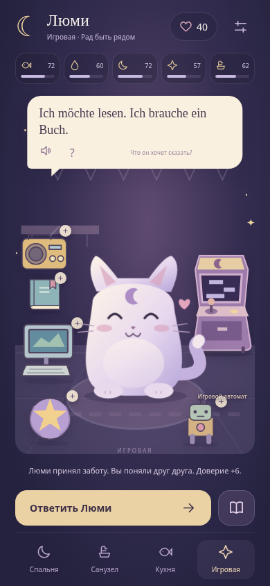
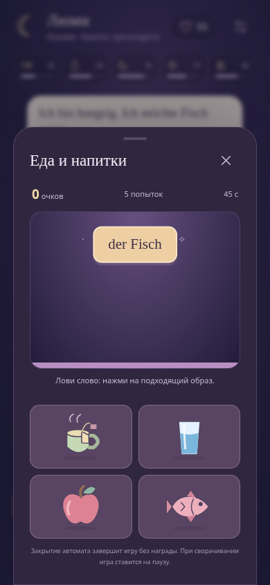

# ☾ Лунный кот · 0.3

## [⬇ Скачать APK для Android · около 4 МБ](https://github.com/einerfriedmann/pokitalk/raw/refs/heads/main/download/pokitalk-demo.apk?v=0.3.0)

Исследуй квартиру со спальней, санузлом, кухней и игровой. Нажимай на предметы: узнавай **der Tisch — стол**, слушай пример и применяй слова в заботе о Люми. В словаре **300 слов, 10 тем** с открытием через доверие.

Отдельная мини-игра **«Падающие слова»** запускается через автомат в игровой комнате. Выбирай подходящий образ до падения слова. Темы: еда, бытовые приборы, кухонные принадлежности.

 

Android 7+. Отладочная версия. Можно установить поверх 0.2 с сохранением прогресса. Для озвучивания нужен немецкий голос в настройках устройства. На реальном телефоне пока не проверено.
